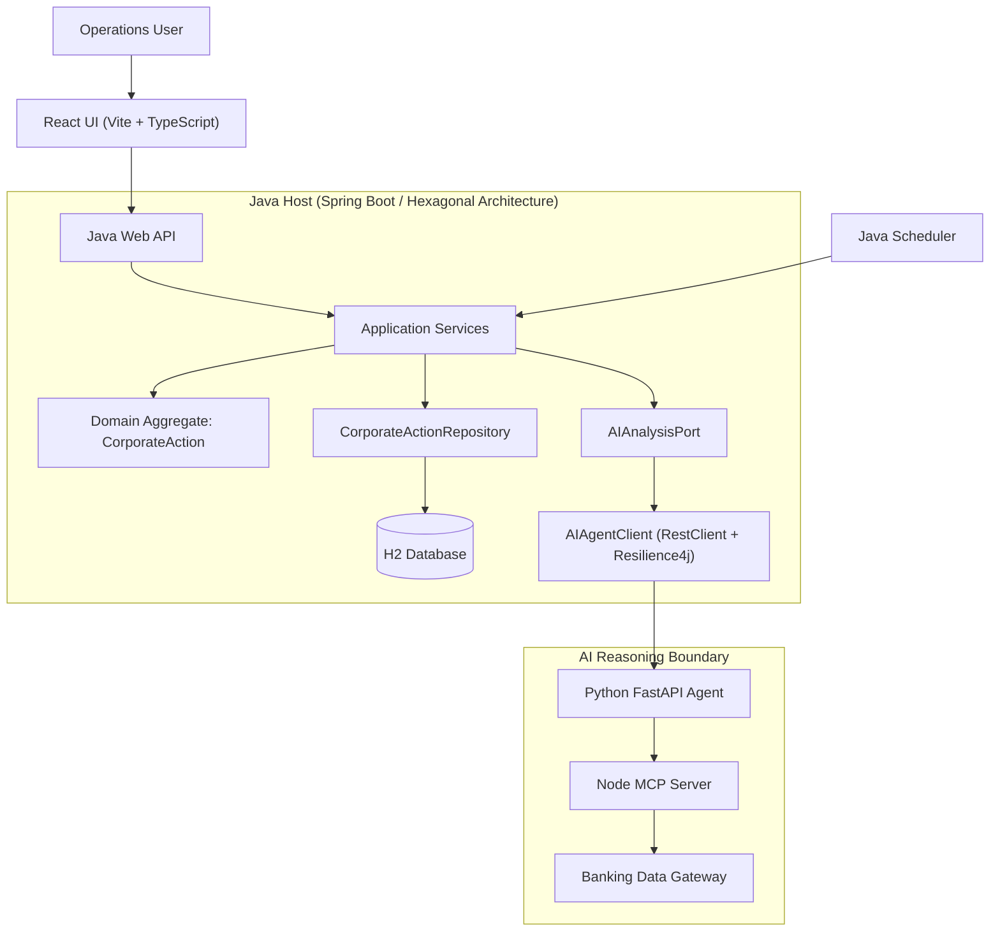
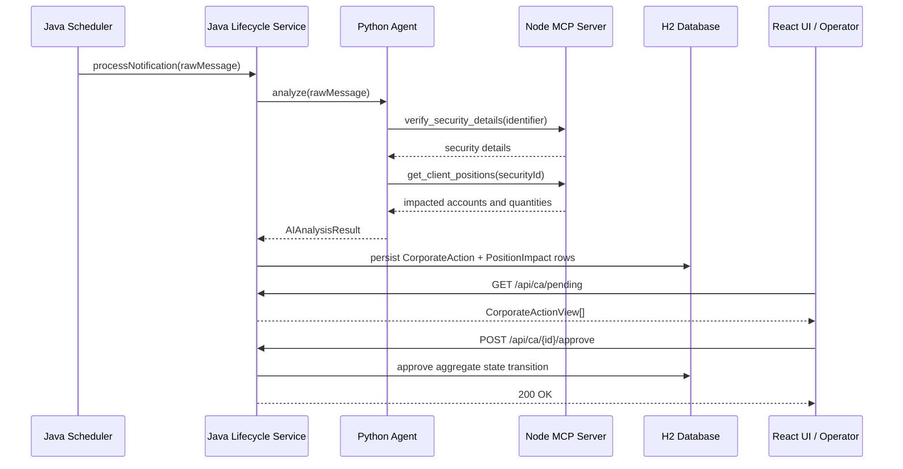

# Corporate Action Trade Lifecycle Architecture

## 1. System Overview

This repository demonstrates an AI-assisted corporate action workflow with explicit human control before trade execution. The system is intentionally split across four runtimes so each concern stays isolated:

- `java-backend`: enterprise host and system of record
- `python-agent`: AI reasoning service
- `node-mcp`: Model Context Protocol server exposing banking tools
- `react-ui`: human-in-the-loop dashboard

The business scenario is a stock-split style corporate action:

1. A notification enters the Java host.
2. The Java host asks the Python agent to analyze it.
3. The Python agent retrieves banking data through MCP tools.
4. The Java host persists the analyzed action and projected impacts.
5. An operator reviews the action in the React UI.
6. Approval is required before the lifecycle can move forward.

## 2. Architectural Intent

### Traditional Automation vs. AI-Native Architecture

| Capability | Traditional Automation | This Repository |
|---|---|---|
| Decision logic | Hardcoded branching rules | AI reasoning delegated to the Python agent |
| Data retrieval | Direct service-to-system coupling | Tool-based retrieval through MCP |
| Core business control | Often mixed with integration code | Preserved in the Java domain/application layers |
| Final execution authority | Fully automated | Human-in-the-loop approval required |
| Verification | Unit tests only | Multi-layer tests plus AI evals |

### Key Design Rules

- Human approval is mandatory before execution.
- The Java backend uses Hexagonal Architecture so domain logic is isolated from AI and infrastructure concerns.
- Database transactions stay short and must not remain open across remote AI calls.
- Domain aggregates own lifecycle transitions and child collections.
- The MCP server uses a layered design with tool names defined in a single source of truth.
- The React UI must avoid duplicate submissions and overlapping polling requests.

## 3. Runtime Topology



## 4. End-to-End Lifecycle



## 5. Component Breakdown

### Java Backend: System of Record

The Java module is the authoritative business host.

- **Domain layer**: `com.demo.ca.domain`
  - `CorporateAction` is the aggregate root.
  - `PositionImpact` entities are owned by the aggregate.
  - Lifecycle rules live inside the aggregate, for example `approve()`.
- **Application layer**: `com.demo.ca.application`
  - `CALifecycleService` orchestrates notification processing, persistence, reads, and approvals.
  - `AIAnalysisPort` defines the boundary to the AI reasoning service.
  - `CorporateActionView` is a read model that prevents persistence leakage and JSON recursion.
- **Infrastructure layer**: `com.demo.ca.infrastructure`
  - `AIAgentClient` calls the Python agent through Spring `RestClient`.
  - `JPARepositories` adapts Spring Data JPA to the domain repository interface.
  - Resilience is applied at the AI boundary.
- **Web layer**: `com.demo.ca.web`
  - `GET /api/ca/pending`
  - `POST /api/ca/{id}/approve`
  - RFC 7807 `ProblemDetail` is used for API error responses.

### Python Agent: Reasoning Layer

The Python service is responsible for:

- interpreting the incoming notification
- deciding which MCP tools to call
- synthesizing the narrative AI analysis
- returning normalized impact data to Java

In the current repo, the reasoning loop is simulated but intentionally shaped like a real agent workflow. The evaluation entrypoint lives in `python-agent/evals/run_evals.py`.

### Node MCP: Tool Exposure Layer

The Node server is the tool boundary between the AI agent and banking data.

- **Domain**: `bankingDataGateway.ts`
- **Application**: `createToolCallHandler.ts`, `toolDefinitions.ts`
- **Infrastructure**: mock banking gateway
- **Bootstrap**: `createServer.ts`

Current tools:

- `verify_security_details`
- `get_client_positions`

Important implementation traits:

- tool names come from shared definitions rather than duplicated strings
- request handling has a top-level `try/catch` so unexpected failures return `isError: true`
- banking access is injected through a gateway, not hardwired into handlers

### React UI: Human-in-the-Loop Control

The React frontend is the operator-facing control plane.

- fetches pending actions from the Java backend
- renders AI analysis and projected account impacts
- disables approval while a request is in flight
- polls without overlapping requests or applying stale responses out of order

This keeps the human approval step explicit rather than implied.

## 6. Domain and Data Architecture

### Aggregate Model

`CorporateAction` is the aggregate root and owns:

- security metadata
- action type and ratio
- key dates (`recordDate`, `exDate`, `payDate`)
- lifecycle status
- AI narrative analysis
- child `PositionImpact` records

The aggregate protects invariants through behavior:

- creation flows through `CorporateAction.analyzed(...)`
- approval is allowed only from `ANALYZED`
- impacts are added through aggregate methods
- exposed impact collections are unmodifiable

### Lifecycle States

```text
PENDING -> ANALYZED -> APPROVED -> EXECUTED
```

Current implemented operator workflow centers on the `ANALYZED -> APPROVED` transition.

### Persistence Strategy

- H2 is the current database for the showcase.
- JPA cascade plus `orphanRemoval` is used for owned impacts.
- `@EntityGraph(attributePaths = "impacts")` is used when loading approval candidates to avoid N+1 behavior.
- API payloads are served from `CorporateActionView` instead of entities.

## 7. Transaction and Consistency Boundaries

The most important transactional rule in the system is: **do not keep a database transaction open while waiting on AI or network calls**.

`CALifecycleService` follows that rule explicitly:

1. Call the AI agent outside a transaction.
2. Parse and validate dates before persistence.
3. Open a short transaction only for saving the aggregate and impacts.

This keeps JDBC connections short-lived and prevents external latency from leaking into persistence behavior.

## 8. Interface Contracts

### Java API

- `GET /api/ca/pending`
  - returns `CorporateActionView[]`
  - used by the React dashboard
- `POST /api/ca/{id}/approve`
  - records the human approval decision

### AI Contract

The Java backend expects the Python agent to return:

- `securityId`
- `actionType`
- `ratio`
- `recordDate`
- `exDate`
- `payDate`
- `aiAnalysis`
- `impacts[]`

### MCP Tool Contract

The AI agent interacts with banking data only through tools, not through direct database or service access.

- `verify_security_details(identifier)`
- `get_client_positions(securityId)`

## 9. Security and Reliability Notes

This repository is a showcase, so it does not yet implement a full end-user authentication system. The current security posture is architectural rather than production-complete:

- human approval is enforced as a business control
- sensitive banking access is isolated behind MCP tools
- unexpected MCP execution failures are contained and surfaced as tool errors
- lifecycle violations return structured API errors

Reliability measures already present:

- Resilience4j circuit breaker and retry around the AI boundary
- short database transactions
- explicit API read models to avoid serialization failures
- stale-response-safe polling in the React UI

## 10. Testing and Evaluation Strategy

The repository intentionally demonstrates a layered verification approach:

- **Java**: unit, web, and persistence tests
- **Python**: API tests plus AI eval harness
- **Node MCP**: tool definition and handler tests
- **React UI**: component and workflow tests with Vitest and Testing Library

This is important to the architecture: correctness is not delegated to the LLM alone. The surrounding platform still provides strong deterministic checks.

## 11. Repository Structure

```text
.
├── java-backend/
│   ├── src/main/java/com/demo/ca/
│   │   ├── domain/
│   │   ├── application/
│   │   ├── infrastructure/
│   │   └── web/
│   ├── src/main/resources/
│   └── src/test/java/
├── python-agent/
│   ├── evals/
│   └── tests/
├── node-mcp/
│   ├── src/
│   │   ├── application/
│   │   ├── bootstrap/
│   │   ├── domain/
│   │   └── infrastructure/mock/
│   └── test/
├── react-ui/
│   └── src/
│       ├── api/
│       ├── components/
│       ├── hooks/
│       └── test/
├── ARCHITECTURE.md
└── README.md
```

## 12. Why This Architecture Fits the Demo

This design keeps the interesting part of the system, AI-assisted reasoning, isolated behind explicit boundaries while leaving business control in conventional software layers:

- Java owns lifecycle and persistence.
- Python owns reasoning.
- MCP owns tool mediation.
- React owns operator review.

That split makes the demo believable as an enterprise architecture, while still being small enough to understand and extend.
